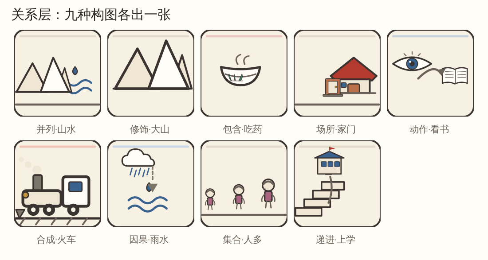
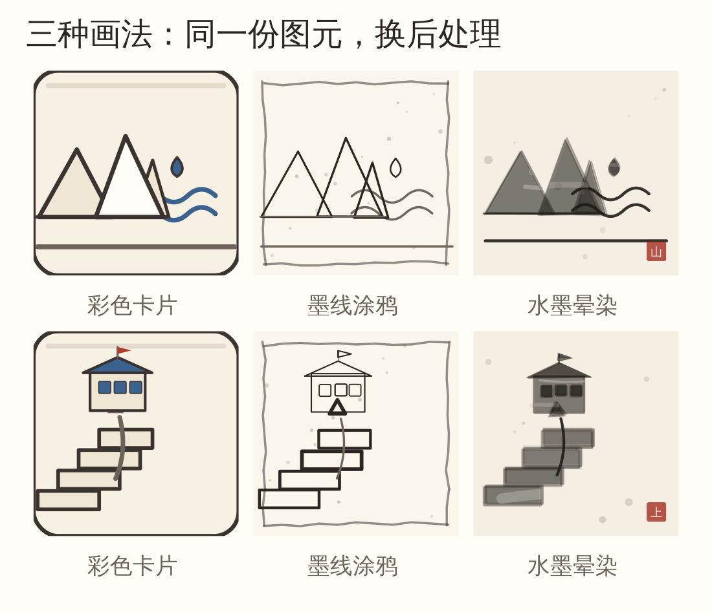
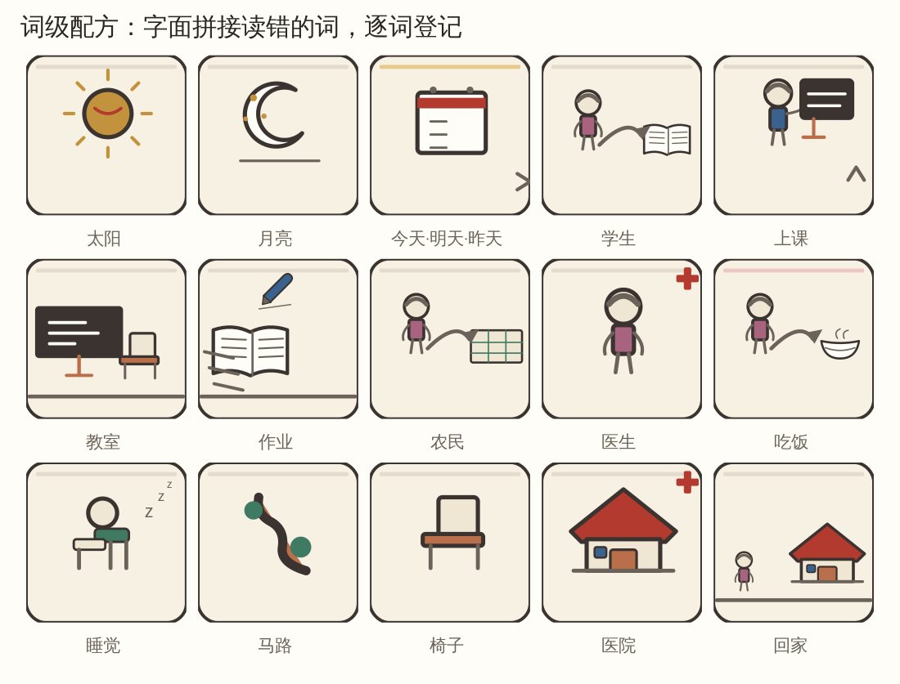
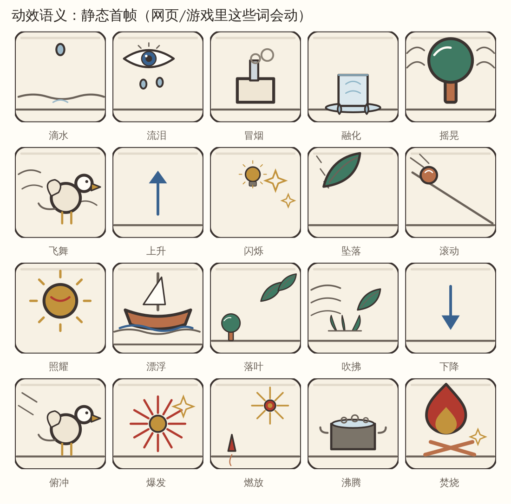
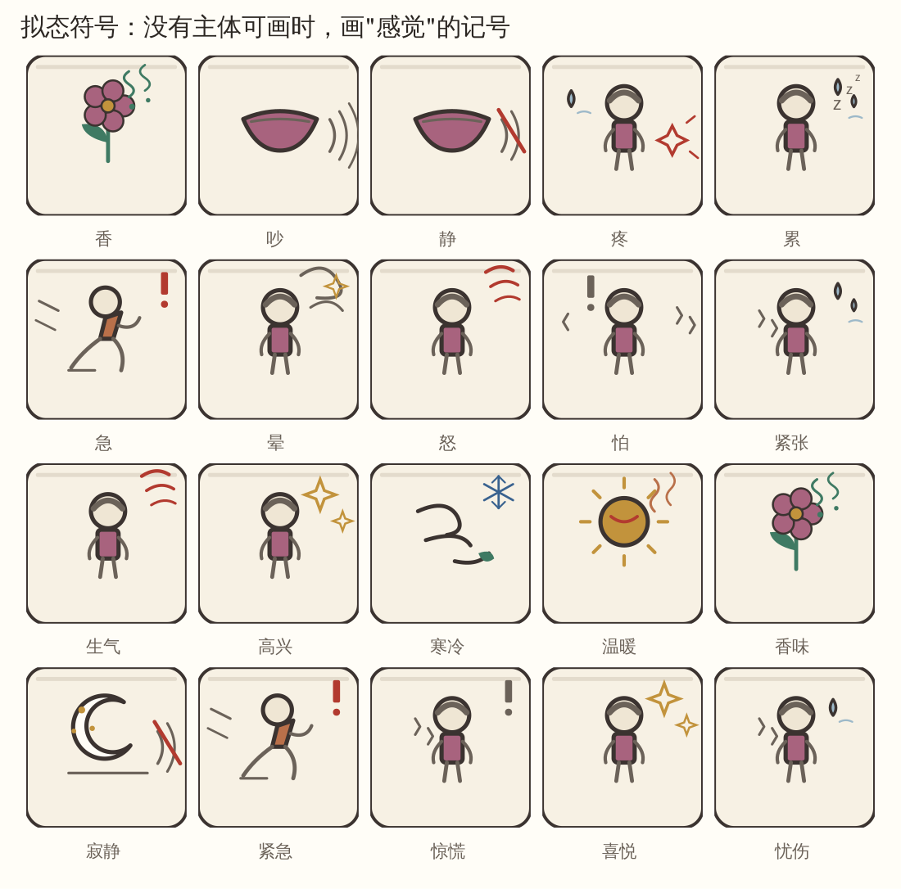
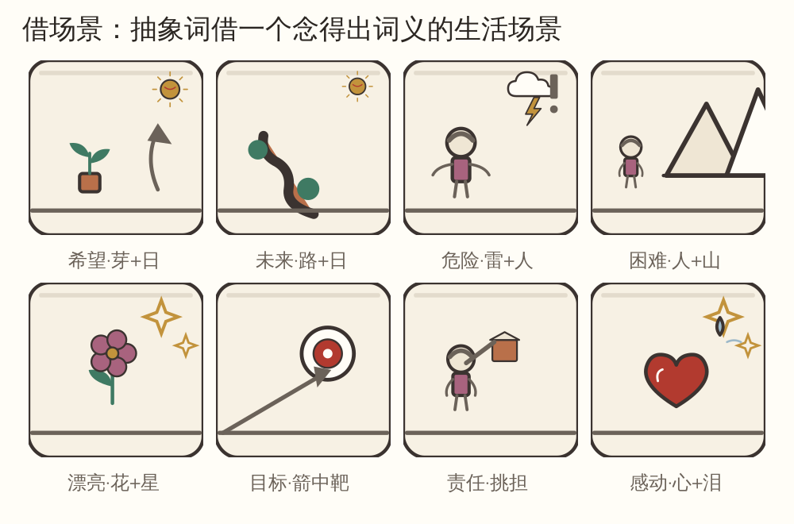
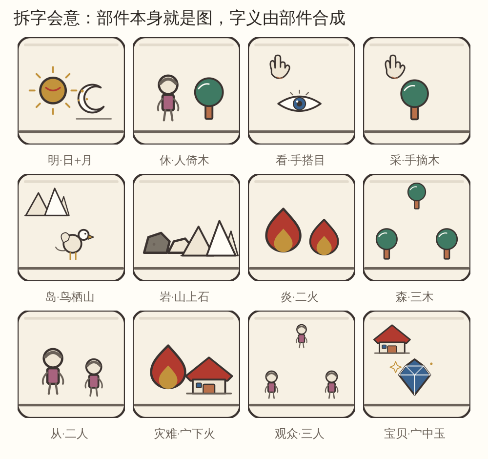
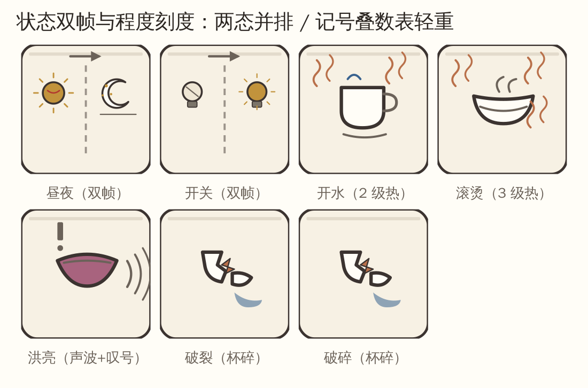
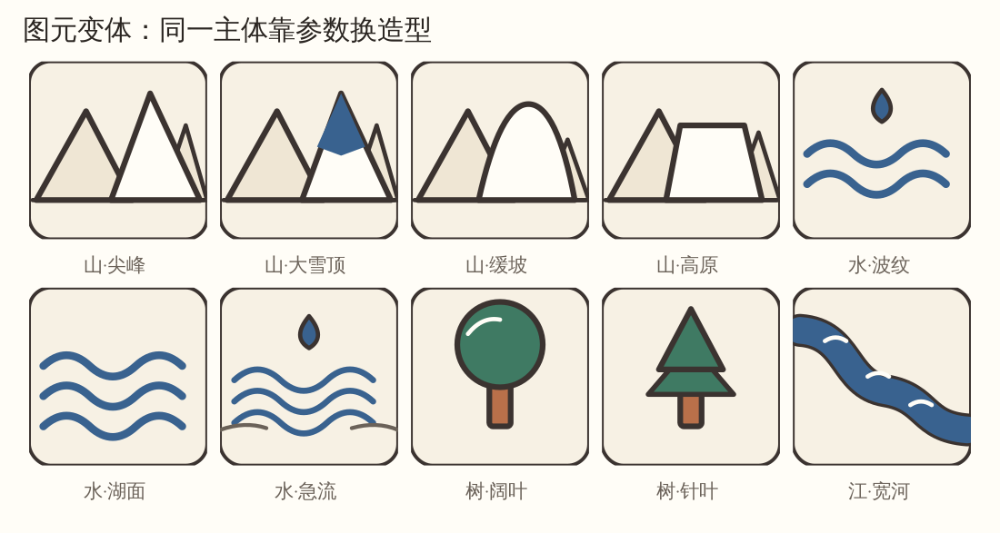

# code-illustration

用**纯代码**（字符串拼 SVG）把汉字/词变成插图的工具包：不调用任何生图模型、不引用任何外部位图，输出可编辑、可批量、体积小、能直接塞进单机 HTML。

> 一个 Agent Skill，也是一个可以独立跑的 Node 脚本库。给一批词配图、做词卡/课件/绘本/分镜，或者给网页加入场逐笔动画时用它。

## 为什么不用生图模型

| | 生图模型 | 本工具包 |
|---|---|---|
| 一致性 | 同一批图风格漂移、细节每次不同 | 参数固定，同批图严格同款 |
| 可改 | 想改一个角，只能重抽 | 改一个数字，全批同步 |
| 体积 | 每张几百 KB 位图 | 单张 SVG 约 1–2 KB |
| 离线 | 要联网、要额度 | 纯本地、零依赖 |
| 文字 | 常写错、常乱码 | 一个字都不生成，全是几何 |

代价是**画面化率**：能被画出来的词是有限的。在我们测试的 14686 个两字词上，可画率约 28%（`scene 3686 / rel 94 / duo 334`，其余走字牌）。这个数字是设计约束，不是 bug——硬画抽象词只会更糟。



## 三种画法

同一份图元，换后处理：



`plain` 彩色（颜色本身承载语义，适合低年级）· `doodle` 墨线涂鸦（只描边，省墨、手账感）· `wash` 水墨晕染（靠多点叠印伪造柔边，适合古诗山水）。

## 在线预览

展示页在 `docs/`，用 `node scripts/site.js --repo https://github.com/ziliu-game/code-illustration` 生成，随仓库一起发布到 GitHub Pages（Settings → Pages → Deploy from branch → `main` / `docs`）。页面是单文件、零外链，四张拼版内联在 HTML 里，画法切换可点。

## 快速开始

```bash
# 单张
node scripts/render.js 山水 out.svg
node scripts/render.js 山水 out.svg --style doodle --size 300 --label

# SVG → PNG（cairosvg 是唯一可靠的本地渲染器）
python3 -c "import cairosvg; cairosvg.svg2png(url='out.svg', write_to='out.png', output_width=600)"

# 批量验收：外链/位图/体积/元素数/过小元素/同构图重复率
node scripts/validate.js 大山 火车 大海
node scripts/validate.js --batch words.json --max-dupe 8

# 重新生成示例拼版（写到 assets/）
node scripts/demo.js
```

## 它怎么把词变成画

四层，缺一层就会退化成"图很抽象"：

```
字 → 图元        每个字映射到一份参数化几何（CHARMAP 176 字 / 83 个图元）
  ↓
修饰字 → 参数     大/小/雪/高… 不进主景，转成缩放、图元参数、记号（MOD）
  ↓
关系 → 构图       两个字先判"是什么关系"，再套固定骨架（relationOf → composeRel）
  ↓
验收              validate.js 用断言替代"打开看一眼"
```

**关系层**是这套东西和"把两个图标并排"最大的区别：

| 关系 | 触发 | 骨架 | 例词 |
|---|---|---|---|
| 递进 | 首字「上/下」+ 可攀主字 | 台阶 + 方向箭头 + 主体在顶端 | 上学 上山 上车 |
| 合成 | 车/船 + 火/云/风/雨 | 主体在前、附属在后上、动势线 | 火车 |
| 因果 | 天气字 + 生长物 | 因在上、果在下、下坠箭头 | 雨水 |
| 包含 | 容器（碗/杯/箱） | 容器占主位、内容物缩进内腔 | 吃药 |
| 场所 | 房/校/田/桥 | 建筑在右、物件在左、门贴墙根 | 家门 |
| 动作 | 手/眼/口/脚/耳/心 | 主体在左、受事在右、作用弧 | 看书 |
| 集合 | 「多」+ 可数主字 | 三个同类、近大远小、全部落地 | 人多 |
| 并列 | 两个具象名词 | 后景小、前景大、靠遮挡读前后 | 山水 |
| 修饰 | 单主字 + 修饰字 | 单主体 + 参数，天气类补参照物 | 大山 大海 |
| 单体 | 单主字 | 单主体居中 | 女人 |

对抗（拔河一类）只有名字没有骨架，语料里没有样本，**未实现**，别当成支持。

两条收敛规则：**同一个东西说两遍**（松树、石头）与**水族近义**（溪水、江水、湖水）不并排画两个，自动收敛成单体，保留更具体的那个造型；**所有元素踩在同一条地平线**（`onGround`，`y = 86 - 100·s`），悬空一律读成漂浮；**关系判不出来就走并列，别硬套**。

## 词级配方：对付"按字取图一定错"的词



`太阳` 的"太/阳"都没有图元，`学生` 会被画成"学校+幼苗"，`马路` 的"马"会画成一头牛——这些问题关系层和缩放参数都救不了，只能逐词登记：

```js
WORDS['学生'] = { hi: 'person', si: 'book', rel: 'ACT' };
WORDS['医生'] = { hi: 'person', mark: [['cross']] };
WORDS['上课'] = { hi: 'teacher', mark: [['arrow', 'up']] };
```

字段：`hi` 主图元、`si` 副图元、`rel` 关系、`hp/sp` 图元参数、`mark` 记号（红十字/睡眠 z/方向箭头/动势线）。当前 41 条。

三条约束保证它不变成手绘大杂烩：**关系层能判对的不登记**；**收敛规则已覆盖的不登记**；**记号只补差别，不替代图元**。

## 词义消歧：一个字在不同词里不是同一个东西

字表一个字只记一个义项，于是"宝石/石子/石头"会画成同一块碎石，"如果"画成苹果，"罕见"画成眼睛。三层处理：

1. `SENSE`——**搭档字选义**（`石+宝→切面宝石`、`石+子→鹅卵石`、`石+头→大石块`、`米+毫→尺`）；
2. `WORDS`——词级配方（`宝石`/`工厂`/`石匠`/`毫米`）；
3. `OPAQUE / ADVERB / META`——**退回字牌**，宁可不画也不画错（`如果`/`力量`/`漂亮`/`目标`）。

代价是覆盖率下降（册内 1296 词 23.9% → 21.1%），换掉 38 个"看着像画对了、其实画的是别的词"的图。

## 审稿表：机器判不了的，人眼判一次

图不会报错，它只会安静地画成**另一个词**（`如果`→苹果、`机会`→汽车、`水塔`→水波）。这部分只能人眼过一遍，所以工具里有个审稿台：

```bash
node scripts/audit.js --batch words.json --out audit.html   # 已画词铺成带编号拼版
node scripts/audit.js --apply bad.txt                       # 判"画错"的写进 PLATES
```

`PLATES` 里的词强制走字牌。册内 1296 词实测：自动规则画出 274 个，人眼判出 63 个"画的是别的词"，其中 3 个补配方、13 个补图元救回，其余退回字牌——覆盖率 23.9% → 17.4%，这是**用覆盖率换准确率**的自觉取舍。

## 动效语义：有些词只能靠"动"讲清楚



`滴水`、`冒烟`、`融化`、`摇晃`、`飞舞`、`坠落`、`滚动`、`闪烁`、`燃放`、`沸腾` 这类词（共 20 个），定格怎么画都差一口气——它们说的是"正在发生"。这批词进 `MOTION` 表，画面自带 SMIL 动画；网页/游戏里会动，PNG/打印/GIF 自动落在最有代表性的首帧。

```js
bodyOf('融化')                 // 带动画的画面
bodyOf('融化', { anim:false }) // 去掉 SMIL，给静态导出与降级
```

用 SMIL 不用 CSS 的原因很实际：接进页面后外壳会改写 `class` 和 `style`，CSS 动画会被覆盖，而 `<animateTransform>` 不是图形元素，能原样存活。册内 1296 词因此多画出 16 个词，覆盖率 17.4% → 18.5%。

## 拟态符号：画不出"那个感觉"，就画它的记号



香、吵、疼、累、急、怒、怕、晕这些词**没有可画的主体**，缺的不是图元，是"感觉怎么画"的约定。漫画早有现成语汇：汗滴=累、三道红色蒸汽弧=怒、上飘热浪=热、冰晶=冷、两缕上行线=气味、三道外扩弧=声音、声波+红斜杠=静、绕头转圈=晕、红锐刺=疼、速度线+感叹号=急、金色星芒=喜、泪滴=悲。15 枚记号收进 `SYM`，和主体图配对出现：

```js
WORDS['害怕'] = { hi: 'person', mark: [['sym', 'sweat'], ['sym', 'tremble']] };
WORDS['幽静'] = { hi: 'moon', si: 'house', rel: 'SIDE', mark: [['sym', 'mute']] };
```

三条机制上的约定：符号只落**四个角槽位**（`SYM_SLOT`，按顺序取，一卡最多两枚，不许压脸）；**同义词可以同图**（`赶忙/赶紧/连忙` 共用"跑者+速度线"），**近义词不行**（`宝石` 与 `石子` 必须长得不一样）；**命中词级配方时单字装饰一律清零**，否则 `热/冷` 自带的那颗色片会飞到右上角盖住符号。

这一层给册内 1296 词补出 19 个感觉/状态词（`寒冷`、`温暖`、`寂静`、`幽静`、`紧急`、`惊慌`、`惊叹`、`喜悦`、`悲哀`、`忧伤`、`繁忙`、`困倦`、`呐喊` 等），覆盖率 18.5% → **20.2%**。它与动效层是两条正交的补语义手段：动效解决"正在发生"，符号解决"这种感觉"。

## 借场景：抽象词借一个"念得出词义"的场景



抽象词没有实体，但多数在生活里有场景。`SCENE` 是一张整幅函数表，两件最多三件图元搭一个场景：

- `希望` = 嫩芽 + 初升的太阳 + 上升箭头
- `困难` = 人 + 一座比自己高得多的山
- `目标` = 靶心 + 一支射中红心的箭
- `责任` = 人肩上挑着担子
- `危险` = 人 + 头顶雷云闪电 + 感叹号
- `漂亮` = 花 + 星芒；`感动` = 心 + 星芒 + 泪；`未来` = 通向远方的路 + 日

判据只有一条：**遮住词牌，把画面念一遍，念的是不是这个词**。`目标`→"射箭打靶"✓；`帮助`（大人指小孩→"指"）、`机会`（开着的门+星芒→"告示牌"）都因念不对而撤掉；`制度`、`逻辑`、`礼貌`、`孤独` 借什么都念不出，留字牌。这一层给册内补出 8 个抽象词，覆盖率 21.8% → **22.4%**，全库 25.5%。

## 拆字会意：部件本身就是图



会意字不必去找"一件对应的东西"，它本来就是部件意义的合：日+月=明、人倚木=休、手搭目=看、宀下火=灾、三木=森、水中有鱼=渔。这一层同时讲对**字形**与**字义**，在识字场景里回报最高。

```js
const HUI = {
  明: { parts: ['sun', 'moon'], lay: 'side' },      // 日月
  看: { parts: ['hand', 'eye'], lay: 'stack' },     // 手搭凉棚
  森: { parts: ['tree', 'tree', 'tree'], lay: 'tri' }
};
const HUI_WORDS = { 灾难: '灾', 渔夫: '渔', 分明: '明', 观众: '众' };
```

三套版式（左右 `side` / 上下 `stack` / 三件 `tri`），18 个字的部件表。规矩很硬：`HUI_WORDS` 里只放"词义 = 字形义"的词——`晶莹`（三日画成三个太阳）、`说明`（讲清楚，不是明亮）、`从来`（跟随，不是一直）都因为"字形对、词义不对"被挡在门外；`好/男/家` 拆得对，但库里没有女、子、力、豕的图元，也不启用。

这一层给册内补出 6 个词（`灾难`、`渔夫`、`渔翁`、`分明`、`明朗`、`明显`），覆盖率 20.7% → 21.1%。

**补件再往上走一步**：`A.person` 本来就带 `dress/hair:'bun'/child` 三个参数，所以"女""子"两个部件不用新画（`好`=女+子）；真缺的只有 `豕`（`A.pig`），补上后 `家` 立住了，`安` 也顺带成立。另补了 `A.crown`/`A.hat`/`A.knife`/`A.bread`，解锁 `国王`、`帽子`、`刀子`、`面包`。抽象词走"借动作"：`力量`=人举石，`有力`=举石+星芒，`努力`=举石+速度线+汗滴。这一步把册内推到 **21.8%**（全库 25.4%）。

## 状态双帧 / 程度刻度：差值词与轻重词



`开关`、`昼夜` 说的不是"一个东西"，而是**两个状态之间的差**；`滚烫`、`冰凉` 说的是**同一个感觉的轻重**。两者的实现都不新增图元：

- **双帧**：`dualPanel(a, b)` 把同一件东西的两种状态各缩到 46% 并排，中间一道虚线 + 箭头。器物图元因此各带状态参数：`A.bulb({on:false})` 灭、`A.door({open:true})` 开、`A.bowl({full:true})` 满、`A.cup({broken:true})` 碎。
- **刻度**：`mark` 里同一枚符号重复写几次就是几级——`开水`（2 道热气）、`滚烫`（3 道），1=轻、2=中、3=重，最多 3 枚。只有紧凑记号能叠（热浪/冰晶/气味线）；声波、星芒这类向外放射的一叠就糊成一团，`洪亮` 因此改成"声波 + 感叹号"。

这一层给册内补出 6 个词（`昼夜`、`开水`、`洪亮`、`破裂`、`破碎`…），覆盖率 20.2% → **20.7%**。它的上限天然很低：册内 1034 个字牌多是抽象名词，够格做双帧/刻度的只有十来个。要再往上抬，得回到"补图元"和"拆字会意"。

## 图元是"零件 + 装配"，不是一物一函数



```js
A.mountain({ shape: 'sharp' | 'round' | 'plateau' | 'double', top: 8, snow: 'heavy' })
A.water({ form: 'waves' | 'lake' | 'rapids', curves: 3, banks: true })
A.tree({ pine: true })
```

判据：**换个参数还认得出是同一个东西 → 加参数；画法结构都变了 → 加函数。**

## 自动验收（GitHub Actions）

`.github/workflows/validate.yml` 在每次 push / PR 时跑五道关：

| 关卡 | 命令 | 挂掉说明 |
|---|---|---|
| 语法 | `node --check scripts/*.js` | 有脚本写坏 |
| 可复现 | `node scripts/demo.js && node scripts/site.js` 后 `git diff --exit-code -- assets docs` | 改了生成器却忘了提交产物 |
| 冒烟 | 三种画法各渲一张并校验非空 | 后处理把图吃空了 |
| 词表验收 | `npm run check`（170 词样本） | 硬伤、同构图超 12 次、或可画率跌破 60% |
| — | 本地等价命令 `npm run check` | 提 PR 前自己先跑一遍 |

样本在 `tests/sample-words.json`（约 170 词，见 `tests/README.md`），**不放完整语料**。

## 目录

```
SKILL.md               Agent Skill 入口（工具怎么用、怎么加东西、交付门槛）
README.md              本文件
CONTRIBUTING.md        贡献指南（四个扩展入口 + 验收门槛）
scripts/
  illus.js             核心：图元、字表、修饰字、关系层、词卡
  doodle.js            墨线涂鸦后处理
  wash.js              水墨晕染后处理
  render.js            单张渲染 CLI
  validate.js          批量验收（含同构图指纹、关系分布）
  demo.js              示例拼版生成（relations/words/variants/styles/motion/symbols）
  site.js              GitHub Pages 展示页生成（docs/index.html）
tests/sample-words.json   CI 回归样本（170 词）+ tests/README.md
.github/workflows/validate.yml  CI：语法/可复现/冒烟/词表验收
  styles.js            12 风格谱系拼版
  anim.js / mk_gif.py  逐笔动画（烘焙帧 / GIF）
references/            icons.md（扩字）、styles.md（画法）、animation.md（动画）、symbols.md（拟态符号）、decomposition.md（拆字会意）、scenes.md（借场景）
assets/                demo 拼版（README 与展示页用）
docs/                  展示页产物（GitHub Pages 从这里发布）
```

## 已知边界

- **烟花式抽象**：高年级词（民主、诚实）画不出来，直接走字牌，不要硬编。
- **符号只覆盖"感觉/状态"**：15 枚记号撑不起"人事物"，`制度`、`逻辑` 照样字牌；符号是补边角语汇，不是万能画笔。
- 关系层靠"主字属于哪类图元"判定，**不是语义理解**：`学生`会画成"学校+幼苗"，因为「生」映射到 sprout。这类错要靠词级构图（`WORDS`）逐词登记。
- `cairosvg` 不支持 `feGaussianBlur`/`feTurbulence`，柔边只能靠多点叠印伪造；ImageMagick 的 SVG 解析器太弱，别拿它转图。
- 涂鸦/水墨是**字符串后处理**，属性正则必须支持带数字的属性名（`x1/y1/x2/y2`），否则 `<line>` 会被画成空元素。

## 路线图

- [x] 修饰字 → 参数（不再是丢弃）
- [x] 关系层（9/10，对抗未实现）
- [x] 图元零件化 + 变体（山/水/海/江/树）
- [x] 自动验收（含同构图重复率）
- [x] 词级配方机制 + 55 条常用词（太阳/学生/上课/医生/吃饭/马路…）
- [x] 字义消歧（`SENSE`/`OPAQUE`）+ 审稿表（`PLATES`）
- [x] 动效语义层（`MOTION`，SMIL，20 词）
- [x] 拟态符号层（`SYM` 15 枚 + `FEEL` 43 词，册内 +19 词）
- [x] 状态双帧（`dualPanel` + 器物状态参数）与程度刻度（符号叠数）
- [x] 拆字会意（`HUI` 21 字 + 白名单 23 词）
- [x] 补部件图元（person 参数化女/子、`pig`/`crown`/`hat`/`knife`/`bread`），解锁 好、安、家、国王、帽子、刀子、面包
- [x] 抽象词"借动作"（力量/有力/努力 = 人举石）
- [x] 抽象词"借场景"（`SCENE` 8 词：希望/未来/危险/困难/漂亮/目标/责任/感动）
- [ ] 符号层继续扩：害羞、香喷喷、乱糟糟这类"程度+感觉"的词
- [ ] 动效词扩到动作语素（落叶/抖动/冲刷…）
- [ ] 继续扩词表：作业本、铅笔盒、雨伞、电话（缺图元的先补图元）
- [ ] 对抗关系骨架
- [ ] 更多零件化：人（姿态/年龄/职业）、车（轿车/卡车/公交）
- [ ] 浏览器/无头渲染替代 cairosvg 的可选校验路径

## 致谢

思路参考了几个公开的同类项目，但**代码是独立写的，没有拷贝它们的文件**：

- [spotkit](https://github.com/Devesh-Shirsath/spotkit) —— "先问关系再选构图"和"每套图只许用一次同一骨架"的克制原则
- [anatomy](https://github.com/wheresryan22/anatomy) —— 零件装配 + 几何自检的思路
- [draw-tech-svg](https://github.com/Mrlyk/SKILLS) —— SVG 交付前做确定性校验的做法

## 许可

MIT，见 [LICENSE](LICENSE)。
